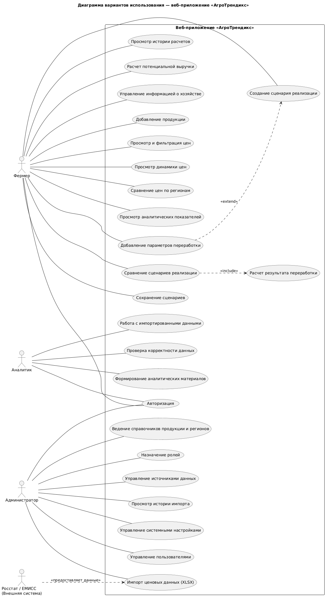
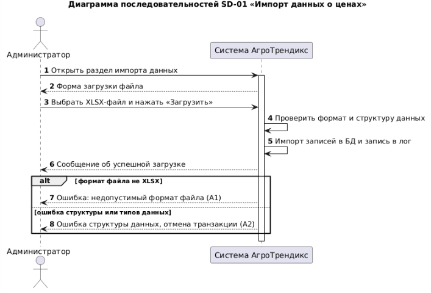
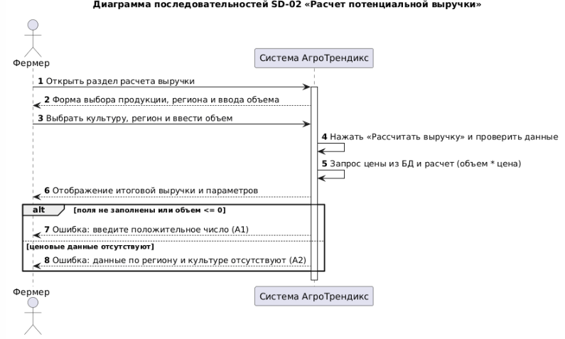
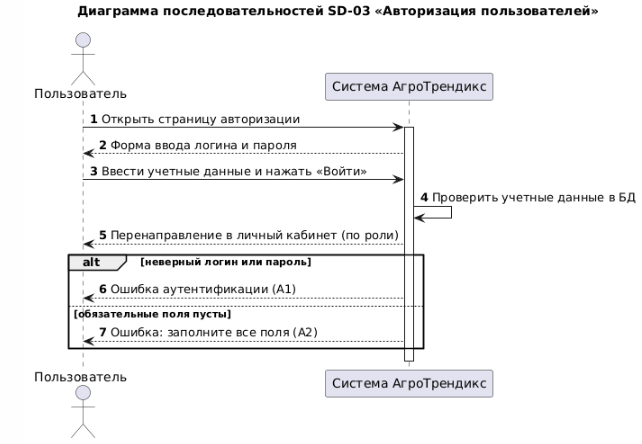
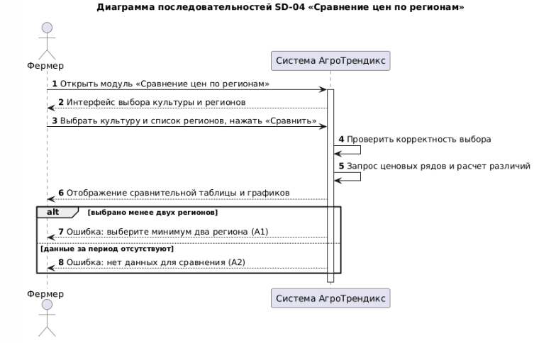
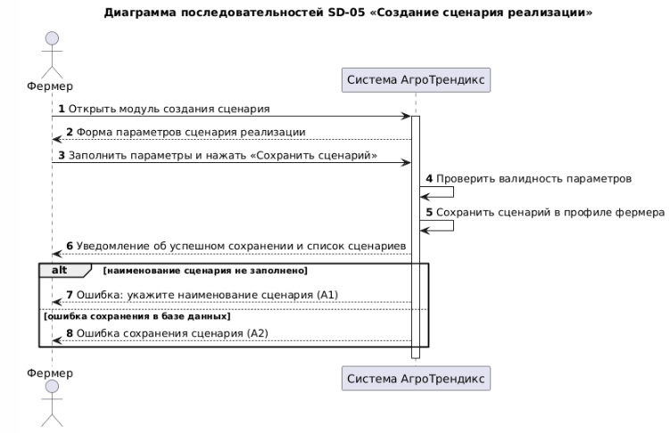

# Общий отчёт по программной инженерии: проект «АгроТрендикс» (AgroTrendix)

Данный документ представляет собой сводный консолидированный отчёт команды по разработке информационно-аналитического веб-приложения **«АгроТрендикс» (AgroTrendix)** по результатам практических занятий № 1–5.

---

## 1. Цель проекта, назначение и границы системы

### 1.1. Назначение системы
Разрабатываемая система **«АгроТрендикс» (AgroTrendix)** предназначена для предоставления сельхозтоваропроизводителям (фермерам, руководителям и экономистам КФХ) актуальной информации о ценах на сельскохозяйственную продукцию и интеллектуального анализа рыночных данных для поддержки принятия обоснованных решений о реализации и переработке произведённой продукции.

### 1.2. Цели разработки
1. Сокращение временных затрат сельхозпроизводителей на сбор, сопоставление и аналитическую обработку ценовой информации из разрозненных источников.
2. Предоставление наглядного инструмента моделирования доходности: оценка потенциальной выручки от прямой продажи сырья в сравнении со сценариями самостоятельной переработки.
3. Повышение обоснованности управленческих решений агробизнеса за счёт прозрачного сопоставления региональных цен и прогнозирования финансовой выгоды.

### 1.3. Границы системы и архитектурный стек
- **Тип приложения:** Информационно-аналитическое веб-приложение на базе веб-фреймворка **Django** (Python 3.12+).
- **База данных:** Реляционная СУБД **PostgreSQL**, обеспечивающая целостность структурированных рядов ценовой динамики и сохранность сценариев пользователей.
- **Интерфейс:** Адаптивный веб-клиент для настольных ПК, ноутбуков, планшетов и мобильных устройств (HTML5, CSS3, JavaScript).
- **Внешние границы:** В границы веб-приложения входит модуль бизнес-логики расчетов, подсистема разграничения прав доступа, база данных и веб-интерфейс. Внешние статистические источники (Росстат, ЕМИСС) находятся за границами системы и взаимодействуют с ней посредством регламентного импорта валидированных структурированных наборов данных (файлы XLSX).

---

## 2. Роли пользователей в системе

В соответствии со спецификацией требований в системе выделены 3 основные роли акторов и 1 внешняя система:

* **Фермер (Сельхозтоваропроизводитель):**
  Основной конечный пользователь системы. Вносит сведения о культурах и объемах собранного урожая, просматривает рыночные цены и графики динамики, моделирует выручку от прямой продажи, настраивает параметры переработки (затраты, коэффициент выхода) и сохраняет альтернативные сценарии реализации для последующего сравнения.
* **Аналитик / Экономист АПК:**
  Исследует ценовые тенденции в разрезе регионов РФ и временных периодов, анализирует агрегированные показатели рынка сельхозкультур, формирует сводные отчеты и материалы для стратегического планирования сбыта.
* **Администратор системы:**
  Отвечает за бесперебойное функционирование платформы: управляет учетными записями пользователей и их правами, актуализирует классификаторы культур (ОКПД2) и справочники регионов, выполняет регламентный импорт статистических массивов XLSX и контролирует журнал аудита загрузок.
* **Росстат / ЕМИСС (Внешняя система):**
  Внешний поставщик официальных открытых статистических сведений о средних ценах производителей сельскохозяйственной продукции.

---

## 3. Перечень требований к системе

### 3.1. Функциональные требования (ФТ)
* **Аутентификация и профиль пользователя:**
  - Регистрация и безопасная авторизация пользователей в системе (ФТ-01, ФТ-02).
  - Ведение профиля хозяйства и параметров производимой продукции (ФТ-03, ФТ-04, ФТ-05).
* **Мониторинг и анализ рыночных цен:**
  - Просмотр актуальных цен сельхозпродукции с фильтрацией по культурам, периодам и субъектам РФ (ФТ-07, ФТ-08, ФТ-09).
  - Визуализация временных рядов и динамики цен на интерактивных графиках (ФТ-10).
  - Сравнение средних цен между выбранными регионами с расчетом абсолютных и относительных отклонений (ФТ-11, ФТ-12).
* **Моделирование сценариев и расчет доходности:**
  - Автоматический расчет прогнозируемой выручки от прямой продажи партии продукции (ФТ-13).
  - Моделирование сценариев переработки продукции (ввод затрат на переработку, коэффициента выхода готового продукта, цены конечной продукции) (ФТ-14).
  - Сравнение сценариев реализации: наглядное сопоставление финансового результата прямой продажи и продажи продуктов переработки (ФТ-15).
  - Сохранение пользовательских сценариев и просмотр истории проведенных расчетов (ФТ-16, ФТ-19).
* **Работа с данными и администрирование:**
  - Импорт наборов ценовых статистических данных из файлов XLSX Росстата и ЕМИСС (ФТ-20).
  - Автоматическая валидация структуры, типов и полноты данных перед загрузкой в БД (ФТ-21).
  - Ведение классификаторов продукции, справочников регионов и единиц измерения (ФТ-22, ФТ-23).
  - Управление учетными записями пользователей и назначение ролей (ФТ-24, ФТ-25).
  - Ведение системного журнала импорта и изменений данных (ФТ-26).

### 3.2. Нефункциональные требования (НФТ)
* **Производительность:** Время отклика веб-интерфейса при фильтрации и базовых расчетах — не более 2 секунд.
* **Надежность и целостность:** Автоматический откат транзакций при обнаружении ошибок валидации в процессе импорта данных, сохранение историчности ценовых рядов.
* **Безопасность:** Хеширование паролей пользователей (PBKDF2/Argon2), разграничение доступа к административным панелям на уровне серверных middleware Django.
* **Эргономика и адаптивность:** Адаптивный дизайн интерфейса для экранов смартфонов, планшетов и широкоформатных мониторов ПК.

---

## 4. Спецификация вариантов использования (Use Cases)

В рамках командной работы детально формализованы и распределены между участниками 5 ключевых прецедентов:

| Идентификатор | Название варианта использования | Ответственный разработчик | Актор | Описание |
| :--- | :--- | :--- | :--- | :--- |
| **UC-01** | Импорт данных о ценах | Шаронова А.И. | Администратор | Загрузка XLSX-файла с ценами Росстата, парсинг, валидация и транзакционная запись в БД. |
| **UC-02** | Расчёт потенциальной выручки | Волкова А.П. | Фермер | Выбор культуры, региона, ввод объема урожая и моментальный расчет выручки по актуальным ценам. |
| **UC-03** | Авторизация в системе | Грунина И.А. | Все пользователи | Ввод учетных данных, верификация хеша пароля, генерация сессии и перенаправление в личный кабинет. |
| **UC-04** | Сравнение сценариев реализации | Даудов Д.Г. | Фермер | Сопоставление сценария прямой реализации партии сырья и альтернативного сценария сбыта переработанной продукции. |
| **UC-05** | Создание сценария реализации | Талибов А.Ю. | Фермер | Фиксация параметров расчета, ввод названия сценария и сохранение записи в личной истории расчетов БД. |

---

## 5. Архитектурные UML-диаграммы проекта

### 5.1. Диаграмма вариантов использования (Use Case Diagram)
Общая диаграмма охватывает все функциональные возможности системы и показывает взаимодействие ролей пользователей с модулями веб-приложения:
- Исходный код PlantUML: [`docs/draw/use_cases.puml`](draw/use_cases.puml)
- Векторная модель Draw.io: [`docs/draw/use_cases.drawio`](draw/use_cases.drawio)
- Графическое представление:

*Ключевые связи прецедентов:*
- `<<extend>>`: между «Добавление параметров переработки» и «Создание сценария реализации» (параметры переработки добавляются опционально при выборе углубленной стратегии).
- `<<include>>`: между «Сравнение сценариев реализации» и «Расчет результата переработки» (сравнение невозможно без расчета показателей доходности переработки).

---

### 5.2. Диаграммы последовательностей (Sequence Diagrams)

#### SD-01: Импорт данных о ценах (UC-01)
Отображает процесс загрузки администратором файлов Росстата, проверку структуры таблиц и сохранение записей цен.
- Исходный код PlantUML: [`docs/draw/sd01_import.puml`](draw/sd01_import.puml)
- Графическая схема:

---

#### SD-02: Расчет потенциальной выручки (UC-02)
Демонстрирует взаимодействие пользователя с интерфейсом ввода объемов, запрос цен из БД и выдачу расчета выручки.
- Исходный код PlantUML: [`docs/draw/sd02_calc.puml`](draw/sd02_calc.puml)
- Графическая схема:

---

#### SD-03: Авторизация в системе (UC-03)
Моделирует передачу логина/пароля, проверку существования аккаунта и хеша в БД, обработку ошибок неверного ввода.
- Исходный код PlantUML: [`docs/draw/sd03_auth.puml`](draw/sd03_auth.puml)
- Графическая схема:

---

#### SD-04: Сравнение сценариев реализации (UC-04)
Показывает сопоставление прямого сбыта и стратегии переработки сельхозсырья с выводом сравнительной таблицы выгоды.
- Исходный код PlantUML: [`docs/draw/sd04_compare.puml`](draw/sd04_compare.puml)
- Графическая схема:

---

#### SD-05: Создание и сохранение сценария реализации (UC-05)
Показывает логику сохранения пользовательского расчетного сценария реализации продукции в реляционную базу данных PostgreSQL.
- Исходный код PlantUML: [`docs/draw/sd05_scenario.puml`](draw/sd05_scenario.puml)
- Графическая схема:

---

## 6. Состав команды и распределение ответственности

| Участник команды | Роль в проекте | Зона ответственности | Отчётные материалы |
| :--- | :--- | :--- | :--- |
| **Шаронова Александра Ивановна** (`@Jaso505`) | Тимлид / Системный архитектор | Архитектура системы, правила внесения изменений (`CONTRIBUTING.md`), исходные материалы, UC-01, SD-01 | [MD](md/sharonova-report_pz5.md) / [DOCX](doc/sharonova-report_pz5.docx) |
| **Грунина Ирина Александровна** (`@grunina-ia`) | Бизнес-аналитик | Сбор и систематизация требований, описание сценариев аутентификации, UC-03, SD-03 | [MD](md/grunina-report.md) / [DOCX](doc/grunina-report.docx) |
| **Волкова Александра Павловна** (`@svaonuaa`) | UX/UI-дизайнер | Проектирование интерфейсов, сценарий расчета выручки, сводная Use Case диаграмма, UC-02, SD-02 | [MD](md/volkova-report_pz5.md) / [DOCX](doc/volkova-report_pz5.docx) |
| **Талибов Артём Юрьевич** (`@mr_sekretnost`) | Backend-разработчик / Владелец репозитория | Инициализация репозитория, конфигурация `.gitignore`, разделы `projects/` и `modules/`, UC-05, SD-05 | [MD](md/talibov-report_pz5.md) / [DOCX](doc/talibov-report_pz5.docx) |
| **Даудов Дауд Гасанович** (`@daudov-dg`) | QA-инженер (Инженер по качеству) | Методология тестирования, анализ альтернативных потоков, сценарии сравнения цен и стратегий, UC-04, SD-04 | [MD](md/daudov-report.md) / [DOCX](doc/daudov-report_pz4.docx) |

---

## 7. Ссылки на материалы и индивидуальные отчёты

- **Исходные методические материалы и задания (ПЗ № 1–5):** в каталоге [`source-material/`](../source-material/README.md).

### Индивидуальные отчёты по практическому заданию № 5 (Организация репозитория):
- **Шаронова А.И.** (Тимлид / Системный архитектор): [MD](md/sharonova-report_pz5.md) / [DOCX](doc/sharonova-report_pz5.docx)
- **Волкова А.П.** (UX/UI-дизайнер): [MD](md/volkova-report_pz5.md) / [DOCX](doc/volkova-report_pz5.docx)
- **Талибов А.Ю.** (Backend-разработчик): [MD](md/talibov-report_pz5.md) / [DOCX](doc/talibov-report_pz5.docx)
- **Грунина И.А.** (Бизнес-аналитик): *в процессе загрузки участником*
- **Даудов Д.Г.** (QA-инженер): *в процессе загрузки участником*

### Индивидуальные отчёты по предыдущим этапам проектирования (ПЗ № 1–4):
- **Шаронова А.И.**: [MD](md/sharonova-report_pz4.md) / [DOCX](doc/sharonova-report_pz4.docx)
- **Волкова А.П.**: [MD](md/volkova-report.md) / [DOCX](doc/volkova-report.docx)
- **Даудов Д.Г.**: [MD](md/daudov-report.md) / [DOCX](doc/daudov-report_pz4.docx)
- **Грунина И.А.**: [MD](md/grunina-report.md) / [DOCX](doc/grunina-report.docx)
- **Талибов А.Ю.**: [MD](md/talibov-report.md) / [DOCX](doc/talibov-report.docx)
